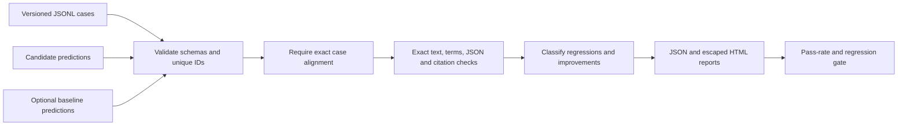

# LLM Evaluation Lab

An evaluation workbench that aligns versioned cases with separate model predictions, compares a baseline, emits JSON and HTML reports, and exits nonzero on regression gates.

## Quick start

```sh
python3 -m llm_eval examples/cases.jsonl examples/candidate.jsonl --baseline examples/baseline.jsonl --out results/local
```

Open `results/local/index.html` to inspect each output, failed assertion, and change classification. Fixtures are synthetic; they are not model benchmark results.

## Evaluation flow



## Input contract

Cases have `id`, `input`, optional `tags`, and nonempty `checks`. Supported checks:

- `exact`: whitespace-trimmed, case-sensitive text equality.
- `contains` / `excludes`: case-insensitive substring assertions.
- `json`: parsed JSON structural equality, preserving scalar type distinctions.
- `citations`: exact set equality of bracketed `src_...` citation IDs.

Predictions have `id`, `output`, `model`, `prompt_version`, `latency_ms`, and `cost_usd`. Cost and latency must be finite and nonnegative. Duplicate IDs, missing predictions, extra predictions, and malformed data are errors; they are never silently dropped.

See `examples/cases.jsonl`, `candidate.jsonl`, and `baseline.jsonl` for complete samples. The supplied candidate passes three fixture cases and improves the retention response over the baseline.

## Reports and CI

Reports include SHA-256 input fingerprints, per-case assertions, tag breakdowns, pass rate, a Wilson 95% interval, nearest-rank p50/p95 latency, and supplied cost totals. The interval is descriptive of this sample and does not correct selection bias or correlated cases.

Exit codes: `0` gate passed; `1` gate failed; `2` invalid input or I/O failure. Defaults require 100% case success and zero regressions. Configure with `--min-pass-rate` and `--max-regressions`.

This runner evaluates saved outputs; it does not generate them or verify reported provider costs. String and structural assertions do not establish semantic truth. Treat datasets and reports as potentially sensitive because they include full outputs.

## Validation

```sh
python3 -m unittest discover -s tests -v
python3 -m compileall -q llm_eval
```

Tests exercise the implemented contracts with synthetic fixtures and isolated temporary databases. Live model inference requires a separately configured Ollama instance and is not covered by these offline checks.

## Development

Python 3.11+; runtime uses the standard library. Read [CONTRIBUTING.md](CONTRIBUTING.md) and [SECURITY.md](SECURITY.md).
